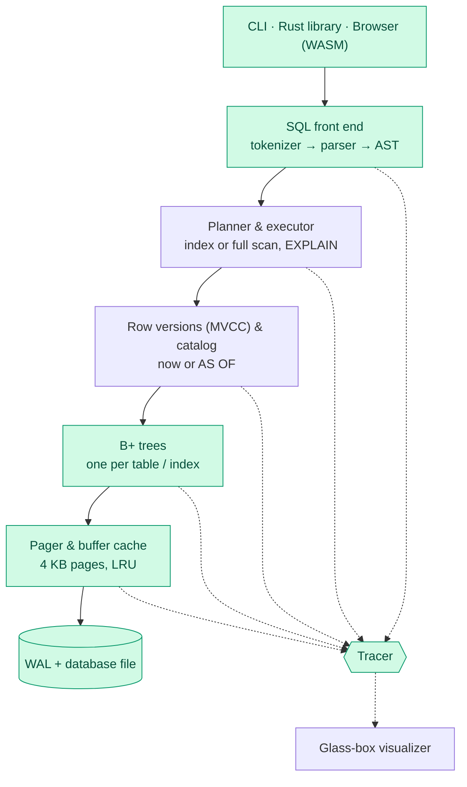

<div align="center">

# GlassDB

**A SQL database engine written from scratch in Rust that you can see inside and rewind.**

[](https://github.com/deepsikhabrahma17-sudo/glassdb/actions/workflows/ci.yml)
[](LICENSE)
[](https://www.rust-lang.org)


</div>

---

GlassDB is a small relational database engine, built layer by layer with **no
database or storage libraries**. Every page, cache frame and log record is
written in this repo. It aims to combine two things small engines rarely offer
together:

- 🔍 **Glass-box mode.** A live browser view of the B+ tree, the page cache, the
  write-ahead log and the query plan, animating as each statement runs.
- ⏪ **Time-travel queries.** Old row versions are kept, so
  `SELECT * FROM users AS OF '2026-11-01 10:00'` returns the table exactly as it was then.

> **Status:** early development. The storage engine (pager, buffer cache,
> B+ tree) and a first SQL layer (tables, `SELECT`/`INSERT`/`UPDATE`/`DELETE`,
> a catalog that survives restarts) work, a write-ahead log keeps them safe
> through crashes, and `BEGIN`/`COMMIT`/`ROLLBACK` group changes into
> transactions. Indexes and time travel are next. See the [roadmap](#roadmap).

## Contents

- [Quick start](#quick-start)
- [What works today](#what-works-today)
- [Architecture](#architecture)
- [Testing](#testing)
- [Project layout](#project-layout)
- [Roadmap](#roadmap)
- [License](#license)

## Quick start

You need [Rust](https://rustup.rs) (stable).

```bash
git clone https://github.com/deepsikhabrahma17-sudo/glassdb.git
cd glassdb
cargo run -p glassdb -- my.db
```

```text
GlassDB 0.1.0 — my.db (0 tables)
Enter SQL ending with ";", or .help for commands.
glassdb> CREATE TABLE students (id INT PRIMARY KEY, name TEXT, grade REAL);
created table students
glassdb> INSERT INTO students VALUES (1, 'Ada', 91.5), (2, 'Bob', 72), (3, 'Cy', NULL);
inserted 3 rows
glassdb> SELECT name, grade + 5 AS curved FROM students
   ...>   WHERE grade IS NOT NULL ORDER BY curved DESC;
 name | curved
------+--------
 Ada  |   96.5
 Bob  |   77.0
(2 rows)
```

The prompt creates `my.db` if it doesn't exist, and everything is still there
the next time you open it. Statements end with `;` and can span lines. Try
`.tables`, `.schema`, `.check` and `.help`, or run the demo script:

```bash
cargo run -p glassdb -- demo.db < examples/demo.sql
```

### See the storage engine at work

```bash
cargo run -p glassdb-core --example pager_tour
```

The tour writes pages through a tiny 3-frame cache and prints every internal
event: cache hits and misses, evictions, disk reads and writes. It also reuses
a freed page, closes, reopens, and dumps the raw header bytes from disk.

```text
== 3. Read page 4 (still cached) and then page 1 (not cached)
   page 4 says: "hello from page 4"
   page 1 says: "hello from page 1"
   [event] cache HIT    page 4
   [event] cache MISS   page 1
   [event] cache EVICT  page 2 (dirty, must save)
   [event] disk  WRITE  page 2
   [event] disk  READ   page 1
```

```bash
cargo run -p glassdb-core --example wal_tour
```

The WAL tour commits to the log, tears a commit record in a fake crash, and
shows recovery keeping whole transactions and dropping the torn one.

```bash
cargo run -p glassdb-core --example txn_tour
```

The transactions tour turns two statements into one commit, spills a transaction
bigger than the cache into the log, rolls it back so the log shrinks again, crashes
halfway through another, and shows a second opener being refused.

```bash
cargo run -p glassdb-core --example btree_tour
```

The B+ tree tour draws the tree after every step while it splits, grows a
level, scans a range along the leaf chain, borrows, merges and shrinks back:

```text
== 2. Insert k04: the leaf overflows, splits, and the root grows a level
   [event] SPLIT   page 1 → right half to page 2, separator "k02" goes up
   [event] GROW    root page 1 now points to pages 3 and 2
   height 2, 2 leaves, 5 entries:
     page 1 (root) internal: k02
       page 3 leaf: k00 k01 → page 2
       page 2 leaf: k02 k03 k04 → end
```

## What works today

| Layer | What it does |
| --- | --- |
| **Pager** | Splits the file into 4 KB pages. Page 0 is a header: magic bytes, version, page count and free-list head |
| **Buffer cache** | A fixed number of in-memory frames with O(1) LRU eviction. Changed pages are written back when evicted or flushed |
| **B+ tree** | Byte-string keys and values in 4 KB slotted pages. Insert with leaf and internal splits, delete with merge or borrow, ordered range scans along linked leaves |
| **SQL** | `CREATE TABLE`, `DROP TABLE`, `INSERT`, `SELECT … WHERE … ORDER BY … LIMIT … OFFSET`, `UPDATE`, `DELETE`. Types `INT`, `REAL`, `TEXT`, `BOOL` and SQL `NULL` logic. Errors point at the line and column |
| **Catalog** | Table definitions live in their own B+ tree on page 1, so the schema survives restarts. `INT PRIMARY KEY` is the row key |
| **Write-ahead log** | Changes go to a checksummed log and commit there first. After a crash, each transaction is either wholly there or not at all. Checkpoints move the log into the main file |
| **Transactions** | `BEGIN`, `COMMIT` and `ROLLBACK`, including `CREATE TABLE` and `DROP TABLE`. A rolled-back transaction leaves no trace, even after a crash. A file lock means one program at a time has a database open |
| **Free list** | Freed pages are linked through themselves and reused before the file grows |
| **Tracer** | Every layer reports events (hit, miss, evict, read, write). They cost nothing when tracing is off and will drive the visualizer |
| **Storage** | A file on disk or a buffer in memory, behind one trait, so the same engine can run in a browser |
| **CLI** | `glassdb <file>` is a SQL prompt: multi-line statements, aligned result tables, `.tables` / `.schema` / `.check` / `.checkpoint`, history |

The exact byte layouts and the reasons behind each decision are in
[docs/DESIGN.md](docs/DESIGN.md).

## Architecture

A statement travels down through the layers, and each layer reports what it
does to the tracer, which feeds the visualizer.



Green layers exist today. The rest are on the [roadmap](#roadmap).

## Testing

Run everything CI runs (formatting, lints, tests) in one go:

```bash
./scripts/check.sh
```

Or run the steps one at a time:

```bash
cargo fmt --all --check
cargo clippy --workspace --all-targets -- -D warnings
cargo test --workspace
```

| Kind | Where | What it proves |
| --- | --- | --- |
| Unit tests | next to the code (`#[cfg(test)]`) | Header encoding, LRU order, eviction, free list, error cases |
| Roundtrip tests | `crates/core/tests/pager_roundtrip.rs` | 1,000 pages written through a 16-frame cache, reopened, and every byte matches |
| Property tests | `crates/core/tests/btree_props.rs` | Random inserts, deletes, lookups and range scans (including 100,000-op runs) always match Rust's `BTreeMap` |
| Transaction property tests | `crates/core/tests/txn_props.rs` | Random transactions, crashes and restarts on a tiny cache always match an in-memory model |
| SQL test files | `tests/sql/*.test` | Statements give exactly the expected output, before and after restarts (54 statements in `basics.test`) |
| CLI tests | `crates/cli/tests/cli.rs` | The real binary runs SQL, prints tables, and refuses non-database files and files already open |
| Lock tests | `crates/core/tests/lock.rs` | A second open is refused and leaves the log alone, and a crash frees the lock |
| Power-cut tests | `crates/core/tests/crash_sim.rs` | A simulated disk loses or tears unsynced writes. The power is cut at every disk operation, and the database must recover exactly, with no rolled-back change coming back |
| Kill tests | `crates/cli/tests/crash.rs` | The real binary gets `kill -9` at 200 random moments. Every confirmed statement survives, no statement or committed transaction is half-applied, and nothing rolled back appears |

Planned: parser fuzzing and benchmarks against SQLite.

## Project layout

```text
glassdb/
├── crates/
│   ├── core/              engine library (glassdb-core)
│   │   ├── src/
│   │   │   ├── btree/     B+ tree nodes, splits, merges, cursors
│   │   │   ├── wal/       write-ahead log: commits and recovery
│   │   │   ├── sql/       tokenizer, parser, syntax tree
│   │   │   ├── exec/      runs statements and transactions
│   │   │   ├── catalog/   the list of tables (page 1)
│   │   │   ├── types/     values and row encoding
│   │   │   ├── pager/     pages, header, buffer cache
│   │   │   ├── storage.rs file and in-memory storage
│   │   │   ├── trace.rs   glass-box event stream
│   │   │   └── error.rs
│   │   ├── examples/      runnable tours
│   │   └── tests/         integration tests
│   └── cli/               the `glassdb` command
├── tests/sql/             SQL test files (.test)
├── examples/demo.sql      a script to pipe into the prompt
├── docs/DESIGN.md         file format and design decisions
└── scripts/check.sh       run the CI checks locally
```

## Roadmap

- [x] **Setup:** workspace, CLI prompt, CI
- [x] **Pager & file format:** 4 KB pages, header, LRU buffer cache, free list, tracer
- [x] **B+ tree:** search, insert with splits, delete with merges, range cursors
- [x] **SQL front end & catalog:** `CREATE`, `INSERT`, `SELECT … WHERE … ORDER BY … LIMIT`, `UPDATE`, `DELETE`
- [x] **Write-ahead log:** checksummed frames, recovery, checkpoints
- [x] **Transactions:** `BEGIN`, `COMMIT`, `ROLLBACK`, one open at a time
- [ ] **Indexes & planner:** `CREATE INDEX`, index scans, `EXPLAIN`
- [ ] **Time travel:** `AS OF`, `HISTORY`, `VACUUM HISTORY`
- [ ] **Glass-box visualizer:** WASM build, live tree / cache / WAL / plan panels
- [ ] **Polish:** benchmarks vs SQLite, hosted browser demo, crates.io release

## License

[MIT](LICENSE)
