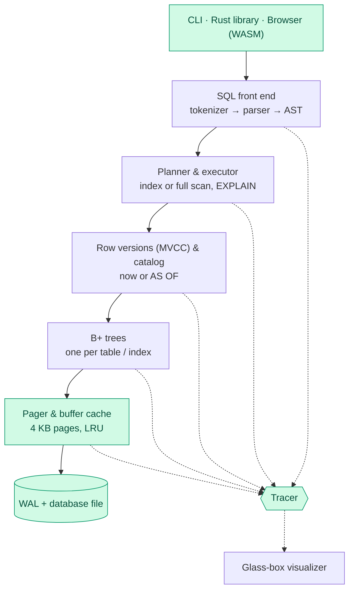

<div align="center">

# GlassDB

**A SQL database engine written from scratch in Rust that you can see inside and rewind.**

[](https://github.com/deepsikhabrahma17-sudo/glassdb/actions/workflows/ci.yml)
[](LICENSE)
[](https://www.rust-lang.org)


</div>

---

GlassDB is a small relational database engine, built layer by layer with **no
database or storage libraries**. Every page, cache frame and log record is
written in this repo. It aims to combine two things small engines rarely offer
together:

- 🔍 **Glass-box mode.** A live browser view of the B+ tree, the page cache, the
  write-ahead log and the query plan, animating as each statement runs.
- ⏪ **Time-travel queries.** Old row versions are kept, so
  `SELECT * FROM users AS OF '2026-11-01 10:00'` returns the table exactly as it was then.

> **Status:** early development. The storage foundation (pager, file format and
> buffer cache) is done. SQL is not available yet. See the [roadmap](#roadmap).

## Contents

- [Quick start](#quick-start)
- [What works today](#what-works-today)
- [Architecture](#architecture)
- [Testing](#testing)
- [Project layout](#project-layout)
- [Roadmap](#roadmap)
- [License](#license)

## Quick start

You need [Rust](https://rustup.rs) (stable).

```bash
git clone https://github.com/deepsikhabrahma17-sudo/glassdb.git
cd glassdb
cargo run -p glassdb -- my.db
```

```text
GlassDB 0.1.0 — my.db (1 page)
Enter ".exit" to quit.
glassdb> hello
hello
glassdb> .exit
```

The prompt creates `my.db` if it doesn't exist. For now it echoes what you type;
SQL arrives with the SQL front end.

### See the storage engine at work

```bash
cargo run -p glassdb-core --example pager_tour
```

The tour writes pages through a tiny 3-frame cache and prints every internal
event: cache hits and misses, evictions, disk reads and writes. It also reuses
a freed page, closes, reopens, and dumps the raw header bytes from disk.

```text
== 3. Read page 4 (still cached) and then page 1 (not cached)
   page 4 says: "hello from page 4"
   page 1 says: "hello from page 1"
   [event] cache HIT    page 4
   [event] cache MISS   page 1
   [event] cache EVICT  page 2 (dirty, must save)
   [event] disk  WRITE  page 2
   [event] disk  READ   page 1
```

## What works today

| Layer | What it does |
| --- | --- |
| **Pager** | Splits the file into 4 KB pages. Page 0 is a header: magic bytes, version, page count and free-list head |
| **Buffer cache** | A fixed number of in-memory frames with O(1) LRU eviction. Changed pages are written back when evicted or flushed |
| **Free list** | Freed pages are linked through themselves and reused before the file grows |
| **Tracer** | Every layer reports events (hit, miss, evict, read, write). They cost nothing when tracing is off and will drive the visualizer |
| **Storage** | A file on disk or a buffer in memory, behind one trait, so the same engine can run in a browser |
| **CLI** | `glassdb <file>` opens or creates a database and gives you a prompt with history |

The exact byte layouts and the reasons behind each decision are in
[docs/DESIGN.md](docs/DESIGN.md).

## Architecture

A statement travels down through the layers, and each layer reports what it
does to the tracer, which feeds the visualizer.



Green layers exist today. The rest are on the [roadmap](#roadmap).

## Testing

Run everything CI runs (formatting, lints, tests) in one go:

```bash
./scripts/check.sh
```

Or run the steps one at a time:

```bash
cargo fmt --all --check
cargo clippy --workspace --all-targets -- -D warnings
cargo test --workspace
```

| Kind | Where | What it proves |
| --- | --- | --- |
| Unit tests | next to the code (`#[cfg(test)]`) | Header encoding, LRU order, eviction, free list, error cases |
| Roundtrip tests | `crates/core/tests/pager_roundtrip.rs` | 1,000 pages written through a 16-frame cache, reopened, and every byte matches |
| CLI tests | `crates/cli/tests/cli.rs` | The real binary creates files, echoes input and rejects non-database files |

Planned: property tests against Rust's `BTreeMap`, crash tests that kill the
process mid-write, parser fuzzing, and benchmarks against SQLite.

## Project layout

```text
glassdb/
├── crates/
│   ├── core/              engine library (glassdb-core)
│   │   ├── src/
│   │   │   ├── pager/     pages, header, buffer cache
│   │   │   ├── storage.rs file and in-memory storage
│   │   │   ├── trace.rs   glass-box event stream
│   │   │   └── error.rs
│   │   ├── examples/      runnable tours
│   │   └── tests/         integration tests
│   └── cli/               the `glassdb` command
├── docs/DESIGN.md         file format and design decisions
└── scripts/check.sh       run the CI checks locally
```

## Roadmap

- [x] **Setup:** workspace, CLI prompt, CI
- [x] **Pager & file format:** 4 KB pages, header, LRU buffer cache, free list, tracer
- [ ] **B+ tree:** search, insert with splits, delete with merges, range cursors
- [ ] **SQL front end & catalog:** `CREATE`, `INSERT`, `SELECT … WHERE … ORDER BY … LIMIT`, `UPDATE`, `DELETE`
- [ ] **Write-ahead log:** checksummed frames, recovery, checkpoints
- [ ] **Transactions:** `BEGIN`, `COMMIT`, `ROLLBACK`
- [ ] **Indexes & planner:** `CREATE INDEX`, index scans, `EXPLAIN`
- [ ] **Time travel:** `AS OF`, `HISTORY`, `VACUUM HISTORY`
- [ ] **Glass-box visualizer:** WASM build, live tree / cache / WAL / plan panels
- [ ] **Polish:** benchmarks vs SQLite, hosted browser demo, crates.io release

## License

[MIT](LICENSE)
